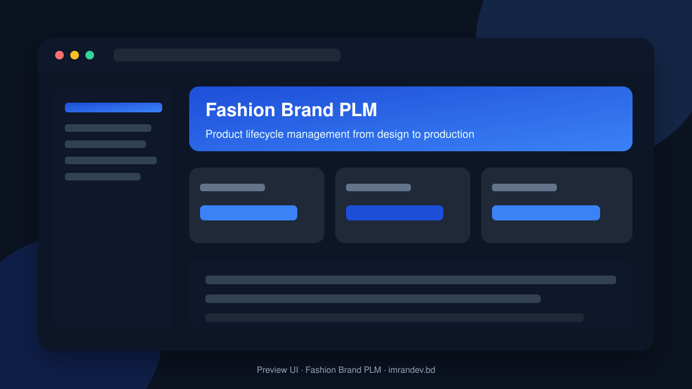
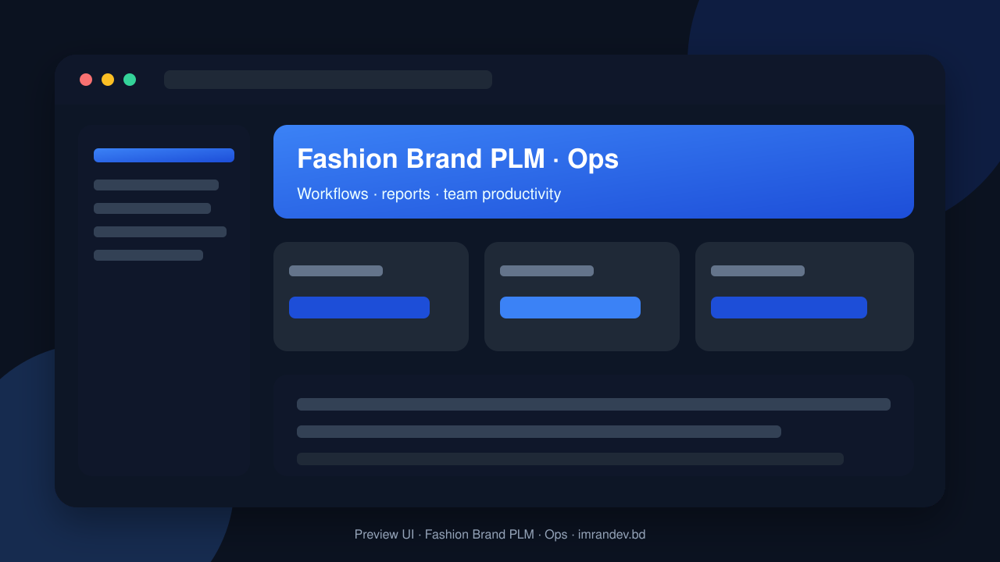

<p align="center">
  
</p>

# Fashion Brand PLM

<p align="center"><strong>Product lifecycle management from design to production</strong></p>

<p align="center">
  <a href="https://github.com/imranbru99/fashion-brand-plm-product-lifecycle"></a>
  
  
</p>

---

## Overview

**Fashion Brand PLM** — Product lifecycle management from design to production.

This README documents the **real application features** so GitHub and Google visitors can understand what the product does.

## Product screenshots

| Dashboard | Operations |
| :---: | :---: |
|  |  |

## Application features

### PLM product lifecycle

- Style / product master from concept to production
- Tech packs, BOM, materials and colorways
- Sampling, fittings and approval workflows
- Costing sheets and margin analysis
- Season / collection planning
- Supplier and factory handoff packages
- QC checkpoints across development stages
- Revision history for designs and specs

### Implemented application modules

- Ai Assistant
- Analytics
- Api
- Bom
- Catalog
- Collections
- Core
- Costing
- Crm
- Design
- Documents
- Finance
- H R
- Hr
- Inventory
- Maintenance
- Materials
- Merchandising
- Notifications
- Orders
- Platform
- Plm
- Production
- Products
- Quality
- Reports
- Sampling
- Shipping
- Sourcing
- Suppliers
- Sustainability
- Tech Pack
- Trims
- Workflow
- Workflows

### Admin screens (Filament resources)

- Collection management
- Product management
- Supplier management

### Domain data models

- Department
- Fashion Product
- Manufacturing Department
- Manufacturing Product
- Plan
- Subscription
- Supply Chain
- Tenant
- Tenant Module

## Tech stack

- PHP 8.2+ / Laravel
- Filament admin (where enabled)
- Migrations, seeders, queues
- Vite asset pipeline
- MySQL / SQLite ready

## Quick start

```bash
git clone https://github.com/imranbru99/fashion-brand-plm-product-lifecycle.git
cd fashion-brand-plm-product-lifecycle
composer install
cp .env.example .env
php artisan key:generate
php artisan migrate --seed
npm install && npm run build
php artisan serve
```

## Author

**Imran Ahmed** · https://imrandev.bd · me@imrandev.bd  
GitHub: https://github.com/imranbru99/fashion-brand-plm-product-lifecycle

---
## 🤝 Let's Connect & Collaborate

I am open to **Senior Remote Full-Stack Roles**, AI Platform Architecture Contracts, and Enterprise Technical Advisory.

| Channel | Link |
| :--- | :--- |
| Portfolio | https://imrandev.bd |
| GitHub | https://github.com/imranbru99 |
| LinkedIn | https://linkedin.com/in/imranbru99 |
| Email | me@imrandev.bd |
| WhatsApp | https://wa.me/8801576918420 |
| Packagist | https://packagist.org/packages/imrandevbd/ |

